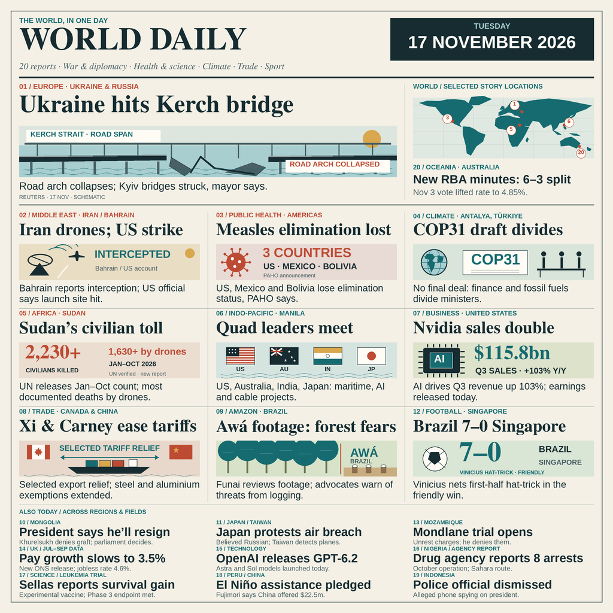

# World Daily — 17 November 2026

[](https://make.fun/bounty/news-image-20261117)
[](https://make.fun/bounty/news-image-20261117)
[](https://make.fun/bounty/news-image-20261117)

An original illustrated newspaper for Tuesday, 17 November 2026, entered in
[make.fun's world news image bounty](https://make.fun/bounty/news-image-20261117).
Twenty reports cover Europe, the Middle East, Africa, the Americas, Asia and
Oceania: conflict, diplomacy, public health, science, climate, politics, jobs,
technology, trade, the Amazon and football.



The artwork uses a warm paper palette, one large lead illustration, a simplified
map indexed to selected reports, nine illustrated panels and nine short briefs.
The date, main headlines and key illustrated figures remain clear in a 300-pixel
preview; the smaller captions and briefs are best read at full size. The captions distinguish
reported claims from verified events and a newly released report from its
historical reporting period. [SOURCES.md](SOURCES.md) records the reporting
sources and those distinctions. No news photographs or copied artwork are used.

## Run

The competition runs `main.py` with Python 3.13 and no network. It writes the
committed image to `/output/entry.png` using only the standard library:

```sh
python3 main.py
```

For a local preview, choose a writable output directory:

```sh
MAKEFUN_OUTPUT_DIR=out python3 main.py
```

The PNG is 1024 × 1024 pixels and below the 1 MiB limit. Every run copies the same
committed bytes. The program needs no downloads, font files or installed packages.

## Rebuild the artwork

`render.py` contains the original drawing and text layout. Rebuilding needs
Pillow, Liberation Sans and Nimbus Roman fonts at the paths named in the script:

```sh
python3 render.py
```

To render a comparison without replacing the committed image, pass
`--out /path/to/draft.png`.

Those dependencies are used only to rebuild the PNG. They are not used by
`main.py` or the competition sandbox.

## License

The code and original artwork are available under the [MIT license](LICENSE).
The factual sources remain the work of their respective publishers. The genuine
AI build transcripts are submitted privately to make.fun with the entry.
